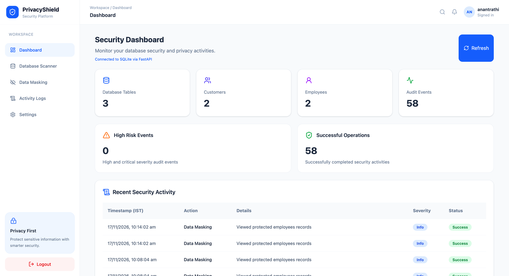
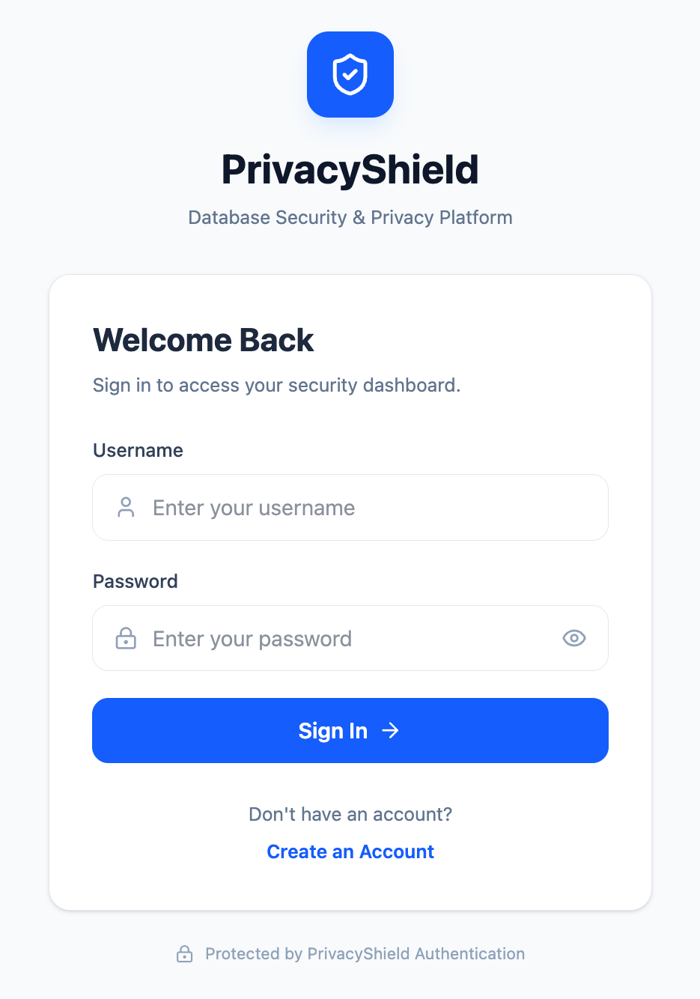
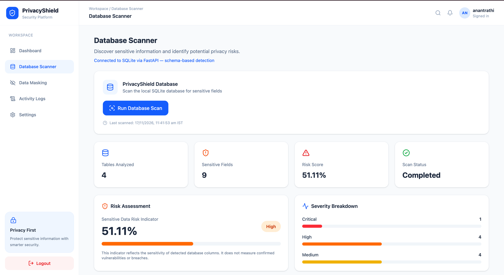
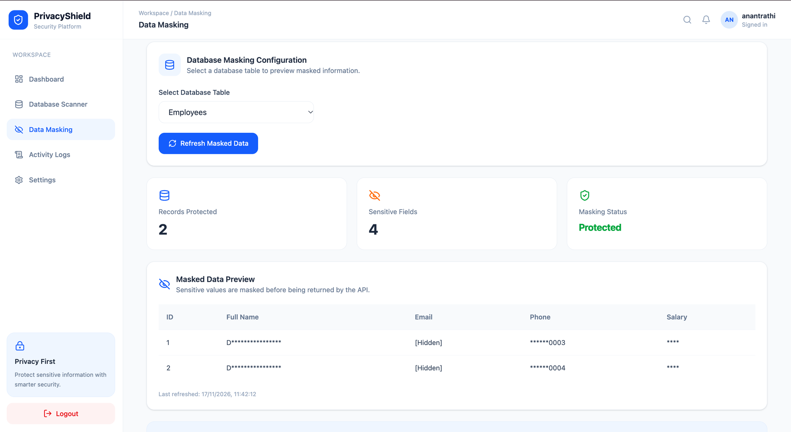
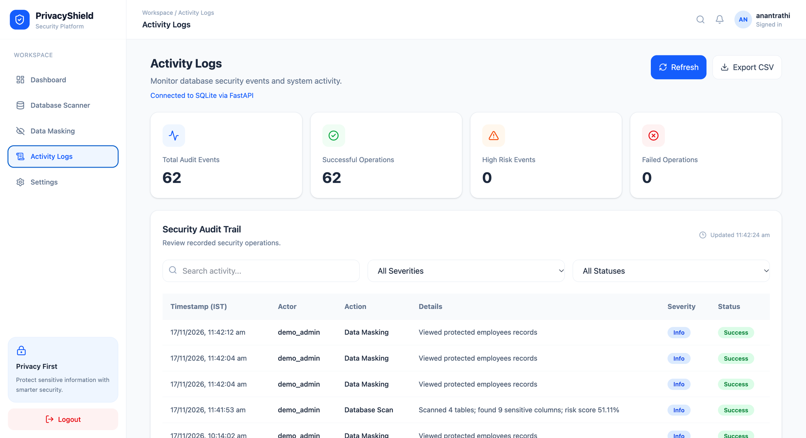
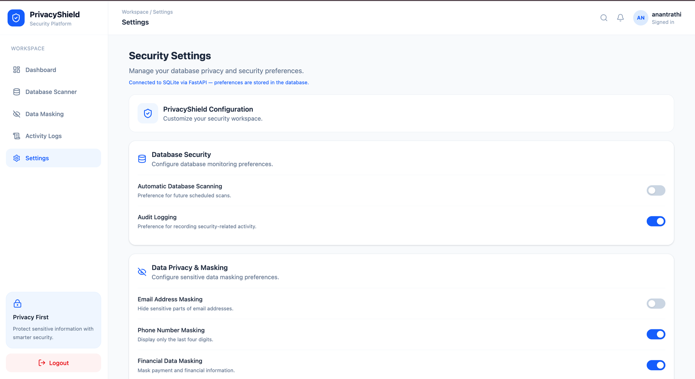
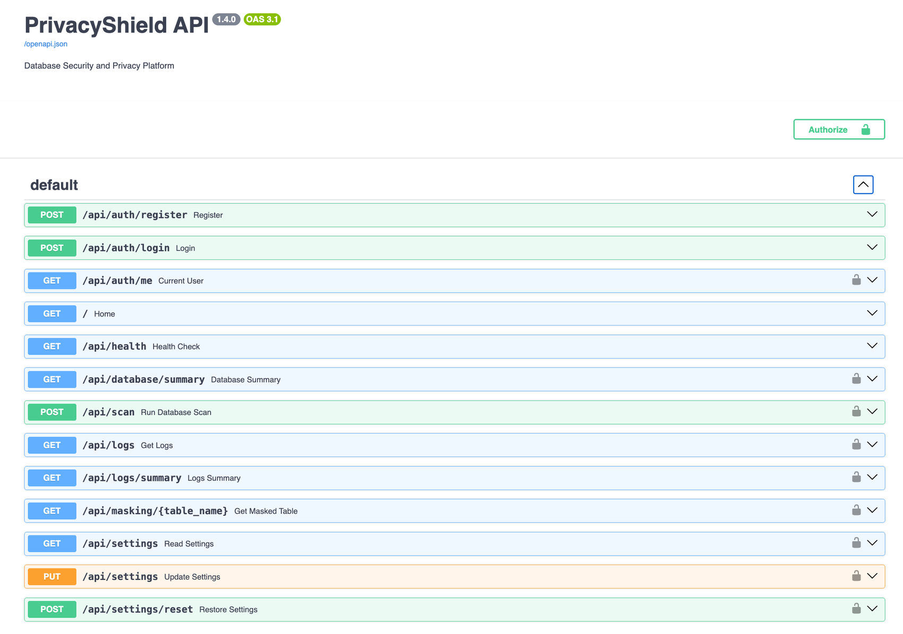
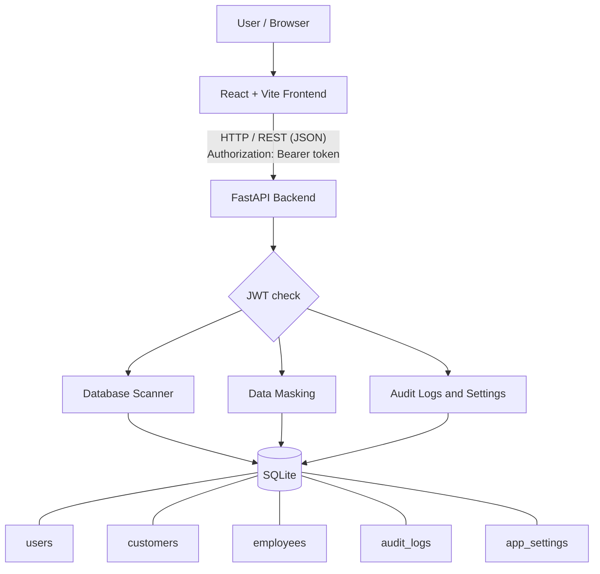

# 🛡️ PrivacyShield

### Database Security and Privacy Platform

*Find sensitive columns · Mask confidential values · Audit every operation · Protect it all behind a login*

**Stack:** React + Vite · FastAPI · SQLite · JWT (HS256) · Argon2 — *Educational prototype*

PrivacyShield is a full-stack web application built for the course . It demonstrates how sensitive data in a database can be **identified, protected, monitored and managed** from one dashboard, behind JWT authentication.



---

## 📑 Table of Contents

- [Project Overview](#-project-overview)
- [Key Features](#-key-features)
- [Screenshots](#-screenshots)
- [Technology Stack](#️-technology-stack)
- [System Architecture](#️-system-architecture)
- [Project Structure](#-project-structure)
- [Installation and Setup](#-installation-and-setup)
- [REST API Endpoints](#-rest-api-endpoints)
- [Security Techniques Implemented](#-security-techniques-implemented)
- [Masking Example](#-masking-example)
- [Limitations](#️-current-limitations)
- [Future Enhancements](#-future-enhancements)
- [Learning Outcomes](#-learning-outcomes)
- [Author](#-author)
- [Disclaimer](#-disclaimer)

---

## 📌 Project Overview

Organizations store customer names, email addresses, phone numbers, payment card details and employee salaries. If that information is exposed through insecure interfaces or careless database operations, it creates serious privacy risk.

PrivacyShield answers with five defensive techniques working together:

| # | Technique | What it does in PrivacyShield |
|---|-----------|-------------------------------|
| 1 | **Authentication** | Only signed-in users can reach protected APIs (JWT) |
| 2 | **Password hashing** | Passwords are stored as Argon2 hashes, never as plaintext |
| 3 | **Sensitive-data identification** | The scanner flags potentially sensitive columns from the schema |
| 4 | **Data masking** | Previews return concealed values; stored records stay unchanged |
| 5 | **Audit logging** | Security-related operations are recorded and can be reviewed |

---

## ✨ Key Features

### 🔐 Authentication
- User registration (username, email, password of **12+ characters**) and login
- **Argon2** password hashing through `pwdlib`
- **JWT** access tokens (HS256, about 30 minutes)
- Token held **in memory** by `api.js`; a browser refresh returns you to the login page
- Any HTTP 401 response logs the user out automatically

### 📊 Dashboard
- Database, customer, employee and audit-event counts
- High-risk and successful-operation summaries
- Five most recent security events
- All values are read from the backend, not hard-coded

### 🔍 Database Scanner
- Examines table schemas and column names (**schema-based detection**)
- Reports tables analysed, sensitive fields, a risk indicator, and a severity breakdown (Critical / High / Medium)
- Lists findings with table, column, data type, category and risk level
- Each scan is written to the audit log

### 🙈 Data Masking
- Masked previews for the **Customers** and **Employees** tables
- Masking is applied **in the backend** before the response is returned
- Original database records are never modified

### 📜 Activity Logs
- Searchable audit trail with severity and status filters
- Pagination (10 per page) and automatic refresh every ~30 seconds
- **CSV export** with a safeguard against spreadsheet formula injection
- Timestamps displayed in IST (Asia/Kolkata)

### ⚙️ Security Settings
- Load, save and reset preferences through the API
- Groups: Database Security, Data Privacy and Masking, Notifications
- Some toggles are saved preferences for planned features (for example scheduled scans and security alerts)

---

## 📸 Screenshots

### Login


### Dashboard


### Database Scanner


### Data Masking


### Activity Logs


### Security Settings


### Swagger API Documentation


-----:|:---------:|
|  |  |

| Database Scanner | Data Masking |
|:----------------:|:------------:|
|  |  |

| Activity Logs | Security Settings |
|:-------------:|:-----------------:|
|  |  |

### Swagger API documentation


---

## 🛠️ Technology Stack

| Category | Technologies |
|----------|--------------|
| Frontend | React, Vite, JavaScript (JSX), React hooks |
| Styling | Tailwind CSS, `App.css`, lucide-react icons |
| Backend | Python, FastAPI, Uvicorn |
| Database | SQLite |
| Authentication | JSON Web Tokens (PyJWT, HS256) |
| Password security | Argon2 (`pwdlib`) |
| API | REST with Swagger UI (OpenAPI 3.1) |
| Tools | VS Code, Git, GitHub |

---

## 🏗️ System Architecture



**Design rule:** the browser never talks to SQLite directly. Every request passes through FastAPI, where the JWT is verified first and sensitive values are masked before anything is returned.

---

## 📁 Project Structure

```text
PrivacyShield/
├── backend/
│   ├── main.py            # FastAPI app and routes
│   ├── auth.py            # JWT and password hashing
│   ├── database.py        # SQLite setup
│   ├── scanner.py         # Schema-based sensitive-column detection
│   ├── masking.py         # Masking functions
│   ├── add_records.py     # Demo data helper
│   └── requirements.txt
├── frontend/
│   ├── public/
│   ├── src/
│   │   ├── App.jsx            # Auth state and navigation
│   │   ├── Login.jsx          # Login and registration
│   │   ├── Dashboard.jsx
│   │   ├── DatabaseScanner.jsx
│   │   ├── DataMasking.jsx
│   │   ├── ActivityLogs.jsx
│   │   ├── SettingsPage.jsx
│   │   └── api.js             # apiFetch() and token handling
│   ├── package.json
│   └── package-lock.json
├── screenshots/
├── .gitignore
└── README.md
```

> SQLite database files, environment secrets, virtual environments and `node_modules` are excluded from Git.

---

## 🚀 Installation and Setup

### Prerequisites

- Python 3.10 or newer
- Node.js and npm
- Git

### 1. Clone the repository

```bash
git clone https://github.com/anantrathi27/PrivacyShield.git
cd PrivacyShield
```

### 2. Set up the backend

```bash
cd backend
python3 -m venv venv
source venv/bin/activate          # Windows: venv\Scripts\activate
python -m pip install -r requirements.txt
```

### 3. Configure the JWT secret

```bash
export PRIVACYSHIELD_JWT_SECRET="$(python -c 'import secrets; print(secrets.token_urlsafe(48))')"
```

On Windows PowerShell:

```powershell
$env:PRIVACYSHIELD_JWT_SECRET = python -c "import secrets; print(secrets.token_urlsafe(48))"
```

> Never commit the real secret. Changing it invalidates tokens signed with the old one.

### 4. Start the backend

```bash
python -m uvicorn main:app --reload --port 8000
```

- API: http://127.0.0.1:8000
- Swagger UI: http://127.0.0.1:8000/docs

### 5. Start the frontend

In a second terminal:

```bash
cd frontend
npm install
npm run dev
```

Open http://localhost:5173 (use the address Vite prints if it differs).

### 6. Try it

1. Create an account and sign in
2. Check the **Dashboard**
3. Run a scan in **Database Scanner**
4. Preview protected records in **Data Masking** (try Employees, then Customers)
5. Find those actions in **Activity Logs**, then try search, filters and CSV export
6. Save a preference in **Settings**
7. Open `/docs`, click **Authorize**, and call a protected endpoint

---

## 🔌 REST API Endpoints

| Method | Endpoint | Description | Access |
|--------|----------|-------------|--------|
| POST | `/api/auth/register` | Register a user | Public |
| POST | `/api/auth/login` | Authenticate and receive a JWT | Public |
| GET | `/` | Home | Public |
| GET | `/api/health` | Health check | Public |
| GET | `/api/auth/me` | Current authenticated user | JWT |
| GET | `/api/database/summary` | Database statistics | JWT |
| POST | `/api/scan` | Run a schema-based scan | JWT |
| GET | `/api/masking/{table_name}` | Masked records for a table | JWT |
| GET | `/api/logs` | Audit records | JWT |
| GET | `/api/logs/summary` | Audit statistics | JWT |
| GET | `/api/settings` | Read settings | JWT |
| PUT | `/api/settings` | Update settings | JWT |
| POST | `/api/settings/reset` | Restore default settings | JWT |

Protected requests must include `Authorization: Bearer <access_token>`. Full interactive documentation is served at `/docs`.

---

## 🔒 Security Techniques Implemented

| Technique | Description |
|-----------|-------------|
| **JWT authentication** | Protected endpoints require a valid, unexpired token signed with HS256 |
| **Argon2 password hashing** | Only password hashes are stored; hashing is one-way, unlike encryption |
| **Server-side data masking** | Values are concealed before the response leaves the backend |
| **Parameterized SQL queries** | User input is kept separate from SQL statements to reduce SQL-injection risk |
| **Audit logging** | Scans and masking previews are recorded for accountability |
| **Sensitive-field detection** | Schema and column-name analysis flags potentially sensitive data |
| **CSV-injection guard** | Exported log values that could run as spreadsheet formulas are neutralized |
| **CORS configuration** | The backend accepts requests and `Authorization` headers from permitted origins |

---

## 🧪 Masking Example

Illustrative stored employee record:

```text
Name:   David Kumar
Email:  david@example.com
Phone:  9876540003
Salary: 65000
```

Masked preview as shown in the Employees view:

```text
Name:   D**********
Email:  [Hidden]
Phone:  ******0003
Salary: ****
```

The Customers view applies the same idea to name, email, phone and card number. Exact output depends on the functions in `masking.py`.

---

## ⚠️ Current Limitations

- Uses SQLite as a local demonstration database
- Detection is **schema-based** (column names), not a content scan or a full vulnerability assessment
- The risk score is a project-specific sensitivity indicator, not a standardized rating or a measure of compromise
- Masking protects displayed values; it does not encrypt the stored data
- Tokens live in browser memory, so a refresh requires signing in again; there are no refresh tokens
- No separate Admin and User roles yet
- Some settings are stored preferences for future features
- Audit logging covers application-level operations only
- Not a replacement for enterprise database security tools

---

## 🔮 Future Enhancements

- [ ] Role-Based Access Control (Admin / User)
- [ ] Content-based scanning (emails, phone numbers, card-like patterns)
- [ ] Scheduled scans and real security alerts
- [ ] Refresh tokens and password reset
- [ ] Database encryption at rest
- [ ] Multi-Factor Authentication (MFA)
- [ ] MySQL and PostgreSQL support
- [ ] Charts for audit trends and risk distribution
- [ ] Automated tests and security reports
- [ ] HTTPS deployment

---

## 🎯 Learning Outcomes

- Database security and privacy concepts
- Full-stack development with React and FastAPI
- REST API design and OpenAPI documentation
- Authentication, JWT and password hashing
- Sensitive-data protection and masking
- Audit logging and accountability
- Secure development practices and honest threat-model boundaries

---

## 👤 Author

**Anant Rathi**

---

## 📄 Disclaimer

PrivacyShield is an educational project that demonstrates selected database security and privacy techniques. It is **not** a production-ready security product and should not protect real sensitive information without further review, testing and hardening.
